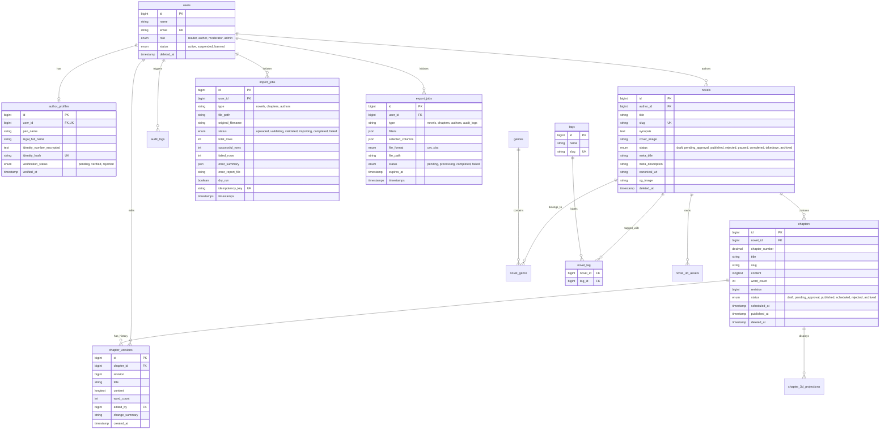
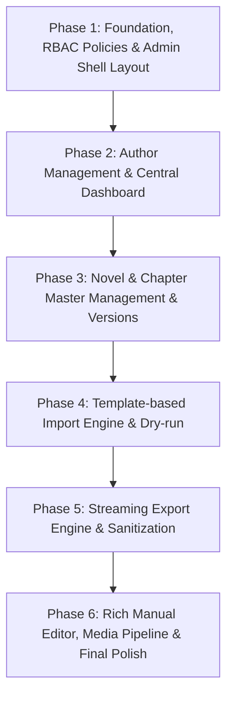

# CMS Admin Masterplan — BRIEF-6 Implementation Plan

> **For agentic workers:** REQUIRED SUB-SKILL: Use superpowers:subagent-driven-development (recommended) or superpowers:executing-plans to implement this plan task-by-task. Steps use checkbox (`- [ ]`) syntax for tracking.

**Goal:** Hoàn thiện toàn diện hệ thống CMS Quản Trị Admin chuyên nghiệp cho nền tảng Novel Engine (Dashboard, Quản lý Tác giả, Quản lý Bài viết/Truyện, Import/Export hàng loạt an toàn, Bộ soạn thảo & Chèn nội dung thủ công, RBAC & Audit Trail) trên nền tảng Laravel 11, Tailwind CSS v3, Alpine.js v3.

**Architecture:** Mở rộng kiến trúc nguyên khối Modular Monolith của Laravel 11: tầng Policy/Gates chuẩn hóa RBAC, FormRequest validate nghiêm ngặt, Service Layer chuyên biệt (`ContentSanitizerService`, `ImportValidationService`, `DataStreamingExportService`), Database Transactions & Optimistic Locking chống xung đột, Queue Jobs xử lý batch tác vụ nặng, và Blade Component System tuân thủ WCAG 2.1/2.2 AA.

**Tech Stack:** PHP 8.2+, Laravel 11.31, SQLite (Dev/Test) / PostgreSQL 16 (Prod), Blade, Tailwind CSS v3.4, Alpine.js v3.17, Vite 5.4.

**Spec:** `BRIEF-6: Khảo sát và lập kế hoạch hoàn thiện hệ thống Admin CMS`

---

## Global Constraints

- HĐH: Windows 11, PowerShell syntax (sử dụng dấu chấm phẩy `;` để chuỗi lệnh, cấm dùng `&&`, cấm dùng `cd`).
- User Role Constraint: `users.role IN ('reader', 'author', 'moderator', 'admin')`. Cấm gán `'role' => 'user'`.
- TDD bắt buộc: Mọi chức năng mới phải tuân thủ nghiêm ngặt quy trình Red -> Green -> Refactor.
- Zero `transition-all`: Luôn chỉ định rõ thuộc tính chuyển động (e.g. `transition-colors`, `transition-opacity`).
- WCAG 2.1/2.2 AA Conformance: Đảm bảo nhãn tiếp cận (Label in Name), độ tương phản màu tối thiểu 4.5:1, kích thước touch target >= 44x44px, ảnh có thuộc tính `width` và `height` rõ ràng chống CLS.
- Formula Injection Defense: Mọi trường văn bản trong file CSV/XLSX export bắt đầu bằng `=`, `+`, `-`, `@`, `\t`, `\r` phải được escape an toàn bằng ký tự `'`.
- Secure Storage: Link tài nguyên nội bộ dùng `Str::startsWith($url, ['http://', 'https://']) ? $url : asset($url)` để tránh lỗi 403 Forbidden.

---

## Review Focus

1. **Broken Access Control & IDOR:** Người dùng hoặc tác giả truy cập/sửa/xóa bài viết hoặc tài liệu e-KYC của người khác; Admin/Moderator không được phân quyền nhưng vượt rào can thiệp cấu hình hệ thống.
2. **CSV / Spreadsheet Formula Injection & CSV Bomb:** Dữ liệu độc hại chứa công thức macro thực thi mã trên máy nhân viên vận hành khi mở file CSV/Excel export hoặc import file nén độc hại làm sập bộ nhớ máy chủ.
3. **Mất dữ liệu và xung đột ghi đè đồng thời (Concurrent Overwrites):** Hai quản trị viên hoặc tác giả cùng sửa một chương/bài viết cùng lúc mà không có cơ chế Optimistic Locking (Revision Lock) dẫn đến mất dữ liệu của người sửa trước.
4. **N+1 Queries & Cạn kiệt bộ nhớ (Memory Exhaustion) khi Export:** Xuất hàng chục nghìn bài viết/tác giả bằng `Model::all()` nạp toàn bộ vào RAM thay vì sử dụng Database Cursor / StreamedResponse.
5. **Dữ liệu mồ côi khi tác giả bị vô hiệu hóa/xóa:** Khi tài khoản tác giả bị khóa (banned/suspended) hoặc xóa, các tác phẩm đã xuất bản bị lỗi khóa ngoại vỡ giao diện độc giả hoặc lộ thông tin nhạy cảm.

---

# Phần A — Executive Summary

### 1. Đánh giá hiện trạng Codebase
Codebase hiện tại là ứng dụng đọc và sáng tác truyện trực tuyến kết hợp sân khấu 3D WebGL (Three.js) xây dựng trên nền tảng **Laravel 11.31**, đã triển khai các cấu trúc cốt lõi đạt tiêu chuẩn pháp lý Việt Nam (NĐ 17/2023 về bản quyền & DMCA, NĐ 13/2023 về bảo vệ dữ liệu cá nhân e-KYC, NĐ 147/2024 về quản lý thông tin mạng) và đạt 179/179 bài test kiểm thử tự động (100% Green).
Tuy nhiên, khu vực quản trị Admin hiện tại mới chỉ là các trang kiểm duyệt rời rạc (`/admin/kiem-duyet`, `/admin/ban-quyen`, `/admin/dinh-danh-tac-gia`, `/admin/nhat-ky-an-ninh`), **chưa có trang Dashboard tổng quan**, **thiếu menu điều hướng tập trung (Sidebar layout)**, **chưa có module quản lý tác giả chuyên sâu**, **chưa có trung tâm quản lý toàn bộ tác phẩm/chương cấp hệ thống**, và **chưa có động cơ Import/Export dữ liệu hàng loạt an toàn theo template**.

### 2. Top 5 rủi ro và khoảng trống quan trọng nhất
1. **Thiếu RBAC cấp phân quyền chi tiết (Policy/Gate Gap):** Chưa có thư mục `app/Policies/`. Quyền kiểm tra hiện chỉ nằm ở middleware cấp cao (`EnsureAdminOrModerator`, `EnsureAuthorVerified`), dễ dẫn tới nguy cơ Broken Access Control (IDOR) khi Admin can thiệp vào bài viết hoặc tài khoản của tác giả mà không có phân quyền cụ thể giữa Super Admin và Moderator.
2. **Nguy cơ Spreadsheet Formula Injection trong luồng Export/Import:** Dữ liệu người dùng (tên tác giả, tiêu đề truyện, nội dung chương) nếu chứa các ký tự điều khiển (`=`, `+`, `-`, `@`, `\t`, `\r`) sẽ kích hoạt mã độc Macro khi cán bộ quản trị tải file CSV về máy mở bằng Microsoft Excel hoặc LibreOffice.
3. **Mất an toàn và vỡ ràng buộc khi Tác giả bị khóa hoặc xóa tài khoản:** Bảng `novels` có khóa ngoại `author_id constrained('users')->cascadeOnDelete()`. Nếu xóa người dùng tác giả, toàn bộ tác phẩm, chương truyện và lịch sử đọc của độc giả sẽ bị xóa sạch khỏi cơ sở dữ liệu. Cần chuyển sang Soft Deletes và kiểm soát trạng thái tài khoản `status` (`suspended`/`banned`).
4. **Thiếu hệ thống lưu trữ lịch sử phiên bản chương truyện (Revision History Snapshot):** Bảng `chapters` hiện chỉ lưu số `revision` tăng dần để khóa lạc quan (optimistic locking), nhưng không lưu nội dung các phiên bản cũ (`chapter_versions`), khiến quản trị viên không thể so sánh diff hoặc khôi phục khi xảy ra lỗi biên tập/phá hoại.
5. **Cạn kiệt tài nguyên (OOM & N+1) khi xử lý tác vụ hàng loạt:** Chưa có cấu trúc queue job / batch streaming cho import và export. Nếu import file 10.000 dòng hoặc export toàn bộ bài viết, tiến trình PHP sẽ timeout (504) và tràn bộ nhớ RAM (OOM).

### 3. Mục tiêu hoàn thiện và phạm vi
- Xây dựng **Admin CMS Portal hoàn chỉnh** có Sidebar điều hướng, Dashboard KPI tương tác thời gian thực, quản lý Tác giả, quản lý Tác phẩm & Chương, và Audit Trail.
- Triển khai **Động cơ Import dữ liệu theo Template 4 bước an toàn** (Upload -> Mapping -> Dry-run Validation -> Batch Commit).
- Triển khai **Động cơ Export Streaming chống Formula Injection** và quản lý file tạm tự động dọn dẹp.
- Nâng cấp **Bộ soạn thảo Zen Editor & Chèn nội dung thủ công** (Paste cleaner từ Word/Docs, chuẩn hóa HTML, xử lý upload media WebP tối ưu).
- Thiết lập **RBAC chặt chẽ bằng Laravel Policies** và kiểm chứng 100% bằng tự động hóa TDD.

---

# Phần B — Audit Matrix

| Module | Trạng thái | Bằng chứng (File/Route/Schema) | Vấn đề & Tác động | Ưu tiên | Hướng xử lý |
|---|---|---|---|---|---|
| **A. Dashboard & Điều hướng** | **Missing** | `resources/views/layouts/admin.blade.php`<br>`routes/web.php` | Chưa có Route `/admin` hoặc `/admin/dashboard`. Header admin không có menu sidebar, buộc quản trị viên phải nhớ URL thủ công. Không có thống kê KPI, biểu đồ hay nhật ký hoạt động gần đây. | **P1** | Xây dựng route `/admin/dashboard`, bộ điều khiển `AdminDashboardController`, layout Sidebar chuẩn Responsive Drawer, thống kê KPI cards (Tổng bài viết, tác giả mới, duyệt chờ, vi phạm). |
| **A. Phân quyền RBAC** | **Partial** | `0001_01_01_000000_create_users_table.php:22`<br>`app/Http/Middleware/EnsureAdminOrModerator.php` | Cột `role` giới hạn enum tĩnh (`reader`, `author`, `moderator`, `admin`). Chưa có Laravel Policies, chưa có phân định chi tiết quyền hạn giữa Admin tối cao và Moderator (Mod không được sửa cài đặt hệ thống hoặc phân quyền). | **P0** | Tạo thư mục `app/Policies/` (`NovelPolicy`, `ChapterPolicy`, `UserPolicy`, `AuthorProfilePolicy`, `ImportExportPolicy`). Đăng ký Gates kiểm tra quyền chi tiết. |
| **B. Quản lý Tác giả** | **Partial** | `app/Http/Controllers/Admin/AuthorKycReviewController.php`<br>`app/Models/AuthorProfile.php` | Chỉ có trang duyệt e-KYC hồ sơ chờ. Hoàn toàn thiếu màn hình danh sách tác giả toàn sàn, tìm kiếm, lọc theo trạng thái, chỉnh sửa thông tin, khóa tài khoản (suspend/ban), và quản lý liên kết tác phẩm khi tác giả bị khóa. | **P1** | Tạo `Admin\AuthorManagementController`, view `admin.authors.index`, `admin.authors.show`, `admin.authors.edit`. Hỗ trợ đổi trạng thái tác giả (`active`, `suspended`, `banned`), xử lý hiển thị cảnh báo trên tác phẩm. |
| **C. Quản lý Bài viết/Truyện** | **Partial** | `app/Http/Controllers/Admin/ModerationQueueController.php`<br>`app/Models/Novel.php`<br>`app/Models/Chapter.php` | Admin chỉ có hàng đợi kiểm duyệt (`admin.moderation.queue`). Thiếu màn hình quản trị toàn bộ danh mục tác phẩm/chương trên hệ thống, phân loại vòng đời bài viết (draft, pending, published, paused, archived, takedown). Thiếu SEO metadata (meta_title, meta_description, og_image) và hệ thống tags. | **P1** | Xây dựng `Admin\NovelManagementController`, `Admin\ChapterManagementController`. Bổ sung migration thêm trường SEO metadata và bảng `tags`, `novel_tag`. Hỗ trợ chuyển trạng thái vòng đời xuất bản. |
| **C. Lịch sử phiên bản (Version History)** | **Missing** | `database/migrations/2026_10_22_000001_add_revision_to_chapters_table.php` | Bảng `chapters` mới chỉ có số nguyên `revision` và `client_uuid` phục vụ khóa lạc quan. Không lưu trữ nội dung cũ qua các lần cập nhật. Không thể xem diff hoặc khôi phục nội dung cũ khi bị xóa/ghi đè nhầm. | **P1** | Tạo bảng `chapter_versions` lưu snapshot lịch sử (`title`, `content`, `word_count`, `edited_by`, `revision`, `created_at`). Cung cấp UI xem diff và nút khôi phục (restore). |
| **D. Import theo Template** | **Missing** | `app/Http/Controllers/Author/BulkChapterController.php` | Hiện chỉ có tính năng tác giả tự dán văn bản thô để tách chương cho truyện cá nhân. Hoàn toàn thiếu luồng Admin Import hàng loạt bài viết/tác giả qua CSV/XLSX, không có template mẫu tải về, không có mapping cột, dry-run validate và báo cáo lỗi theo dòng. | **P0** | Xây dựng `Admin\ImportWizardController`, `ImportValidationService`, bảng `import_jobs`. Cung cấp template CSV/XLSX, wizard 4 bước, kiểm tra trùng slug, validate schema, transaction rollback và xuất CSV báo cáo lỗi. |
| **E. Export theo Template** | **Partial** | `app/Http/Controllers/Admin/AuditLogExplorerController.php:30` | Chỉ mới có tính năng export Audit Logs ra file JSON. Hoàn toàn thiếu chức năng xuất danh sách tác phẩm, chương, tác giả ra file CSV/XLSX với bộ lọc linh hoạt. Chưa có cơ chế chống CSV Formula Injection và chống tràn RAM khi dữ liệu lớn. | **P1** | Xây dựng `Admin\ExportController`, `DataStreamingExportService`. Áp dụng `fputcsv` streaming với `cursor()`, escape an toàn chống Formula Injection (`'`, `=`, `+`, `-`, `@`), mã hóa UTF-8 with BOM, và tự động xóa file tạm sau 24h. |
| **F. Chèn bài thủ công & Paste cleaner** | **Partial** | `app/Http/Controllers/Author/ChapterEditorController.php`<br>`app/Services/ContentSanitizerService.php` | Đã có `ContentSanitizerService` lọc thẻ độc hại cơ bản, nhưng editor là textarea đơn giản. Chưa có bộ chuyển đổi/chuẩn hóa khi dán văn bản từ Microsoft Word/Google Docs (bị rác thẻ style, font, span rườm rà). Chưa có pipeline upload ảnh chèn vào nội dung bài viết và tối ưu sang WebP. | **P2** | Nâng cấp bộ soạn thảo trong Admin CMS, bổ sung phương thức `sanitizeWordPaste()` trong `ContentSanitizerService`, tích hợp upload ảnh kéo-thả với kiểm định MIME type, đổi tên hash an toàn và nén WebP. |
| **G. Database & Schema Invariants** | **Partial** | `database/migrations/2026_10_21_000002_create_novels_and_genres_tables.php:24` | `author_id` dùng `cascadeOnDelete()`. Nếu xóa user tác giả sẽ mất sạch truyện. Thiếu SoftDeletes trên `novels` và `chapters`. Thiếu index tổng hợp phục vụ truy vấn admin lọc `(status, created_at)` hoặc tìm kiếm nhanh. | **P0** | Migration thêm `deleted_at` (SoftDeletes) trên `novels` và `chapters`. Đổi ràng buộc xóa thành an toàn (`restrictOnDelete` hoặc cập nhật trạng thái tác giả thay vì xóa cứng). Thêm compound indexes. |
| **H. Bảo mật & Kiểm soát lỗ hổng** | **Partial** | Toàn bộ controllers & views | Rủi ro CSV Formula Injection khi xuất file; nguy cơ upload file giả mạo đuôi ảnh (MIME spoofing); rủi ro N+1 query khi hiển thị bảng dữ liệu admin với hàng loạt quan hệ lồng nhau; thiếu Rate Limiting trên các route Import/Export. | **P0** | Triển khai phòng vệ nhiều lớp: Formula Sanitizer, File header magic byte validation, eager loading chặt chẽ (`with()`), và rate limiting (`throttle:60,1`). |

---

# Phần C — Sitemap và UX/UI Plan

### 1. Cấu trúc điều hướng Admin (Navigation Tree)
```
Admin Control Panel (/admin)
│
├── 📊 Bảng điều khiển (Dashboard) [/admin/dashboard]
│   ├── KPI Cards (Tác phẩm, Tác giả, Độc giả, Lượt xem, Tố cáo chờ)
│   ├── Biểu đồ tăng trưởng bài viết & lượt đọc (7 ngày / 30 ngày)
│   ├── Bảng hàng đợi kiểm duyệt khẩn cấp (Quick Action Queue)
│   └── Hoạt động hệ thống gần đây (Live Audit Feed)
│
├── 📚 Quản lý Tác phẩm & Bài viết [/admin/tac-pham]
│   ├── Danh sách tác phẩm (Bộ lọc: Tác giả, Thể loại, Trạng thái, Độ tuổi)
│   ├── Thêm mới tác phẩm thủ công [/admin/tac-pham/tao-moi]
│   ├── Chỉnh sửa tác phẩm & SEO Metadata [/admin/tac-pham/{id}/chinh-sua]
│   ├── Quản lý danh sách chương [/admin/tac-pham/{id}/chuong]
│   │   ├── Thêm chương mới & Soạn thảo [/admin/tac-pham/{id}/chuong/tao-moi]
│   │   ├── Chỉnh sửa chương [/admin/tac-pham/{id}/chuong/{chapterId}/chinh-sua]
│   │   └── Lịch sử phiên bản & Khôi phục [/admin/tac-pham/{id}/chuong/{chapterId}/lich-su]
│   └── Danh mục & Thẻ bài viết [/admin/the-loai-va-the]
│
├── ✍️ Quản lý Tác giả [/admin/tac-gia]
│   ├── Danh sách tác giả toàn sàn (Tìm kiếm bút danh, tên thật, email, trạng thái)
│   ├── Hồ sơ chi tiết tác giả & Danh sách tác phẩm liên kết [/admin/tac-gia/{id}]
│   ├── Chỉnh sửa thông tin tác giả [/admin/tac-gia/{id}/chinh-sua]
│   ├── Quản lý trạng thái (Kích hoạt, Tạm ngưng, Khóa vĩnh viễn)
│   └── Duyệt hồ sơ định danh e-KYC (NĐ 13/2023 & NĐ 147/2024) [/admin/dinh-danh-tac-gia]
│
├── 📥 Nhập xuất Dữ liệu (Batch Data Hub) [/admin/du-lieu]
│   ├── Import bài viết & tác giả theo template [/admin/du-lieu/nhap-du-lieu]
│   │   ├── Bước 1: Tải template mẫu (CSV/XLSX) & Upload file
│   │   ├── Bước 2: Khớp cột dữ liệu (Column Mapping)
│   │   ├── Bước 3: Xem trước & Chạy thử kiểm tra lỗi (Dry-run Validation)
│   │   └── Bước 4: Xác nhận nạp & Tải báo cáo lỗi (Commit & Error Report)
│   └── Export bài viết, tác giả, báo cáo [/admin/du-lieu/xuat-du-lieu]
│       ├── Bộ lọc phạm vi (Trạng thái, thời gian, thể loại)
│       ├── Chọn trường dữ liệu (Column Selector)
│       └── Tải file an toàn (Streaming CSV/XLSX chống Formula Injection)
│
├── 🛡️ Cổng Kiểm duyệt & An ninh Mạng [/admin/kiem-duyet]
│   ├── Hàng đợi duyệt truyện & chương mới [/admin/kiem-duyet]
│   ├── Xử lý tranh chấp bản quyền DMCA (NĐ 17/2023) [/admin/ban-quyen]
│   └── Nhật ký an ninh & Audit Logs Explorer (NĐ 147/2024) [/admin/nhat-ky-an-ninh]
│
└── ⚙️ Cấu hình Hệ thống & Phân quyền [/admin/cau-hinh]
    ├── Quản lý Tài khoản Quản trị & Vai trò (RBAC) [/admin/cau-hinh/tai-khoan]
    ├── Cấu hình kiểm duyệt nội dung & Từ khóa cấm [/admin/cau-hinh/bo-loc-tu]
    └── Cấu hình lưu trữ, dọn dẹp file tạm và thông số hệ thống [/admin/cau-hinh/thong-so]
```

### 2. Thiết kế Layout & Thành phần Giao diện (UI Design System)
Tuân thủ các nguyên tắc thiết kế từ `ui-ux-pro-max`, `frontend-design`, và `web-design-guidelines`:
- **Admin Shell:** Layout 2 cột gồm Sidebar cố định bên trái (chiều rộng 260px trên Desktop, có thể thu gọn collapsible thành 72px icon-only, và chuyển thành Off-canvas Drawer trên thiết bị di động/tablet với lớp phủ backdrop và bẫy focus bàn phím chuẩn ARIA).
- **Hệ màu & Tương phản (Accessible Dark/Light/Sepia Tokens):**
  - Chế độ Dark (Mặc định cho Admin): Nền `bg-slate-950`, bề mặt thẻ `bg-slate-900/80 border-slate-800`, chữ chính `text-slate-100`, chữ phụ `text-slate-400` (đạt tỷ lệ tương phản >= 5.8:1, vượt chuẩn WCAG AA 4.5:1).
  - Màu thương hiệu (Brand Accent): Indigo-600 (`#4f46e5`), Amber-500 (`#f59e0b` cho cảnh báo/chờ duyệt), Emerald-500 (`#10b981` cho thành công/xuất bản), Rose-500 (`#f43f5e` cho từ chối/khóa).
- **Typography:** Phông chữ hệ thống `Plus Jakarta Sans` cho toàn bộ giao diện dashboard, số liệu và bảng dữ liệu; kết hợp `Cinzel` cho tiêu đề trang trọng và `Lora` cho khung xem trước nội dung truyện.
- **Quy tắc chuyển động:** Tuyệt đối không dùng `transition-all`. Luôn ghi rõ `transition-[color,background-color,border-color,opacity,transform] duration-200`.

### 3. Ma trận trạng thái UI (State Matrix)
Mọi trang danh sách, bảng dữ liệu và form đều bắt buộc hỗ trợ đủ 6 trạng thái giao diện:
1. **Loading State:** Sử dụng Skeleton UI dạng xung nhịp nhẹ (`animate-pulse`) mô phỏng đúng cấu trúc bảng dữ liệu (Table Rows Skeleton) thay vì spinner tròn đơn điệu gây giật bố cục (CLS = 0).
2. **Empty State:** Hình minh họa vector nhẹ, thông điệp rõ ràng bằng tiếng Việt (ví dụ: "Chưa có tác giả nào phù hợp với bộ lọc"), kèm nút hành động chính (CTA: "Xóa bộ lọc" hoặc "Tạo tác giả mới").
3. **Success State:** Thông báo Toast thông minh góc phải trên (hoặc Alert banner), tự động ẩn sau 4 giây kèm nút đóng thủ công, có vai trò `role="status"` cho trình đọc màn hình.
4. **Error State:** Hiển thị khung cảnh báo màu đỏ (`bg-rose-500/10 border-rose-500/20 text-rose-300`), liệt kê chi tiết từng lỗi nghiệp vụ hoặc mã lỗi HTTP cụ thể kèm nút "Thử lại".
5. **Disabled State:** Nút và input bị khóa có `disabled`, độ mờ `opacity-50`, con trỏ `cursor-not-allowed`, và nhãn giải thích lý do khi hover hoặc focus.
6. **Permission Denied (403):** Trang thông báo thương hiệu hiển thị rõ: "Bạn không có quyền truy cập chức năng này (Yêu cầu vai trò: Quản trị viên)", kèm nút quay về Dashboard an toàn.

---

# Phần D — Database và API Design

### 1. Sơ đồ Quan hệ Thực thể (Mermaid ERD)


### 2. Chi tiết Migration mới cần bổ sung
1. `add_soft_deletes_and_seo_to_novels_table`:
   - Thêm `softDeletes()` (`deleted_at`).
   - Thêm `meta_title` (varchar 160, nullable), `meta_description` (varchar 255, nullable), `canonical_url` (varchar 255, nullable), `og_image` (varchar 255, nullable).
   - Thêm compound index: `index(['status', 'created_at'])`, `index(['author_id', 'status'])`.
2. `add_soft_deletes_and_status_to_chapters_table`:
   - Thêm `softDeletes()` (`deleted_at`).
   - Thêm enum status `archived`.
   - Thêm index: `index(['novel_id', 'status', 'chapter_number'])`.
3. `create_chapter_versions_table`:
   - `id`, `chapter_id` (foreignId constrained cascade), `revision` (unsignedBigInteger), `title` (string), `content` (longText), `word_count` (unsignedInteger), `edited_by` (foreignId nullOnDelete), `change_summary` (string nullable), `created_at` (useCurrent).
   - Index: `index(['chapter_id', 'revision'])`.
4. `create_tags_and_novel_tag_tables`:
   - Bảng `tags`: `id`, `name` (100), `slug` (120, unique), `timestamps`.
   - Bảng `novel_tag`: `novel_id`, `tag_id`, `primary(['novel_id', 'tag_id'])`.
5. `create_import_and_export_jobs_tables`:
   - Bảng `import_jobs` và bảng `export_jobs` với schema như thiết kế ở Mermaid ERD, index theo `user_id` và `idempotency_key`.

### 3. Danh sách API Endpoints & Phân quyền

| Nhóm chức năng | Method | Route URI | Tác vụ | FormRequest / Policy | Quyền hạn yêu cầu |
|---|---|---|---|---|---|
| **Dashboard** | `GET` | `/admin/dashboard` | Hiển thị KPI, biểu đồ và hàng đợi nhanh | `AdminOrModCheck` | Admin, Moderator |
| **Tác giả** | `GET` | `/admin/tac-gia` | Danh sách tác giả (search, filter, paginate) | `AuthorPolicy::viewAny` | Admin, Moderator |
| **Tác giả** | `GET` | `/admin/tac-gia/{id}` | Chi tiết hồ sơ tác giả & tác phẩm | `AuthorPolicy::view` | Admin, Moderator |
| **Tác giả** | `PUT` | `/admin/tac-gia/{id}` | Cập nhật thông tin tác giả | `UpdateAuthorRequest` | Super Admin |
| **Tác giả** | `POST` | `/admin/tac-gia/{id}/trang-thai` | Đổi trạng thái (Active/Suspend/Ban) | `ChangeUserStatusRequest` | Super Admin |
| **Tác phẩm** | `GET` | `/admin/tac-pham` | Danh sách toàn bộ tác phẩm trên sàn | `NovelPolicy::viewAnyAdmin` | Admin, Moderator |
| **Tác phẩm** | `GET` | `/admin/tac-pham/tao-moi` | Giao diện tạo tác phẩm thủ công | `NovelPolicy::createAdmin` | Super Admin |
| **Tác phẩm** | `POST` | `/admin/tac-pham` | Lưu tác phẩm mới | `StoreAdminNovelRequest` | Super Admin |
| **Tác phẩm** | `PUT` | `/admin/tac-pham/{id}` | Sửa tác phẩm & SEO metadata | `UpdateAdminNovelRequest` | Admin, Moderator |
| **Tác phẩm** | `DELETE`| `/admin/tac-pham/{id}` | Xóa mềm tác phẩm (Soft Delete) | `NovelPolicy::deleteAdmin` | Super Admin |
| **Chương** | `GET` | `/admin/tac-pham/{id}/chuong` | Quản lý danh sách chương của truyện | `ChapterPolicy::viewAnyAdmin` | Admin, Moderator |
| **Chương** | `POST` | `/admin/tac-pham/{id}/chuong` | Tạo chương mới từ Admin CMS | `StoreAdminChapterRequest` | Admin, Moderator |
| **Chương** | `PUT` | `/admin/chuong/{id}` | Cập nhật nội dung chương & ghi version | `UpdateAdminChapterRequest` | Admin, Moderator |
| **Phiên bản** | `GET` | `/admin/chuong/{id}/lich-su` | Xem danh sách các phiên bản cũ & diff | `ChapterPolicy::viewHistory` | Admin, Moderator |
| **Phiên bản** | `POST` | `/admin/chuong/{id}/khoi-phuc/{version}` | Khôi phục nội dung về phiên bản chỉ định | `ChapterPolicy::restoreHistory`| Super Admin |
| **Import** | `GET` | `/admin/du-lieu/nhap-du-lieu`| Giao diện Import Wizard 4 bước | `ImportJobPolicy::view` | Super Admin |
| **Import** | `GET` | `/admin/du-lieu/mau-import/{type}` | Tải template file mẫu CSV chuẩn | `ImportJobPolicy::downloadTemplate` | Super Admin |
| **Import** | `POST` | `/admin/du-lieu/tai-len` | Upload file và phân tích cấu trúc cột | `UploadImportFileRequest` | Super Admin |
| **Import** | `POST` | `/admin/du-lieu/kiem-tra-chay-thu`| Chạy thử nghiệm (Dry-run validate) | `DryRunImportRequest` | Super Admin |
| **Import** | `POST` | `/admin/du-lieu/xac-nhan-nap` | Commit lưu dữ liệu hàng loạt | `CommitImportRequest` | Super Admin |
| **Import** | `GET` | `/admin/du-lieu/bao-cao-loi/{jobId}` | Tải CSV danh sách lỗi chi tiết theo dòng | `ImportJobPolicy::downloadErrors` | Super Admin |
| **Export** | `GET` | `/admin/du-lieu/xuat-du-lieu`| Giao diện cấu hình bộ lọc xuất dữ liệu | `ExportJobPolicy::view` | Admin, Moderator |
| **Export** | `POST` | `/admin/du-lieu/tao-export` | Kích hoạt tác vụ xuất file streaming | `CreateExportRequest` | Admin, Moderator |
| **Media Upload**| `POST` | `/admin/media/tai-anh-soan-thao` | Upload ảnh chèn vào bài viết (WebP) | `UploadEditorImageRequest` | Admin, Moderator |

---

# Phần E — Import/Export và Manual Editor

### 1. Luồng nghiệp vụ Import theo Template (4 Bước an toàn)
```
[1. Upload File] ──> [2. Column Mapping] ──> [3. Dry-Run Validation] ──> [4. Confirmation & Commit]
       │                                                │                               │
       ▼                                                ▼                               ▼
Kiểm tra MIME type,                          Quét dữ liệu từng dòng,         Mở Database Transaction,
Dung lượng <= 10MB,                          Kiểm tra trùng Slug/Email,      Chèn dữ liệu theo Batch (100 rows),
Định dạng CSV/XLSX UTF-8                     Báo cáo lỗi chi tiết cột/dòng   Đánh dấu trạng thái 'draft',
(Có cờ Idempotency Key)                      (Cho phép tải Error CSV)        Tạo bản ghi Audit Log đầy đủ
```

- **Quy định Template CSV chuẩn:**
  - Bắt buộc mã hóa `UTF-8 with BOM` để hiển thị tiếng Việt có dấu chuẩn xác 100% trên cả Microsoft Excel Windows và macOS.
  - Template Bài viết (`novel_template.csv`):
    - Cột bắt buộc: `tieu_de` (string 255), `but_danh_tac_gia` (string 100, phải tồn tại trên hệ thống), `the_loai` (phân cách bằng dấu phẩy), `tom_tat` (text).
    - Cột tùy chọn: `do_tuoi` (`all`/`13_plus`/`16_plus`/`18_plus`), `ban_quyen` (`original`/`authorized_translation`/`public_domain`), `tu_khoa_seo` (tags), `meta_description`.
  - Template Chương truyện (`chapter_template.csv`):
    - Cột bắt buộc: `slug_truyen` (string), `so_chuong` (decimal, ví dụ 1.0, 2.0), `tieu_de_chuong` (string), `noi_dung` (text hoặc HTML an toàn).
- **Quy tắc Kiểm tra & Báo cáo lỗi (Dry-run Validation):**
  - Thực hiện kiểm tra toàn bộ file trong bộ nhớ tạm mà không ghi vào database.
  - Phân loại lỗi theo `Số dòng (Row Number)` - `Tên cột (Field)` - `Nguyên nhân chi tiết (Error Message)`.
  - Ví dụ: `Dòng 4 | Cột: but_danh_tac_gia | Bút danh 'Hắc Miêu' không tồn tại trên hệ thống`.
  - Cung cấp nút tải file `error_report_job_123.csv` phản ánh chính xác các dòng lỗi để người dùng sửa đổi và nạp lại.
- **Rollback & Idempotency:**
  - Sử dụng `DB::beginTransaction()` và `DB::commit()`. Nếu xảy ra lỗi hệ thống nghiêm trọng, tự động `DB::rollBack()` hoàn toàn.
  - Sử dụng `idempotency_key = sha256(user_id + filename + file_size + file_hash)` để ngăn chặn việc người quản trị bấm đúp (double-click) gây trùng lặp dữ liệu.
  - Tất cả bài viết và chương được import bắt buộc thiết lập mặc định ở trạng thái `draft`, không bao giờ tự động `published` ra ngoài trang chủ khi chưa được quản trị viên duyệt.

### 2. Luồng nghiệp vụ Export dữ liệu an toàn
- **Lọc dữ liệu & Chọn trường:**
  - Cho phép người dùng lọc theo khoảng ngày tạo, trạng thái xuất bản, danh mục thể loại, hoặc tác giả cụ thể.
  - Cho phép chọn danh sách các cột cần xuất (ví dụ chỉ lấy ID, Tiêu đề, Tác giả, Ngày tạo, Lượt xem; bỏ qua nội dung dài nếu chỉ cần báo cáo thống kê).
- **Phòng vệ Formula Injection (Cực kỳ quan trọng):**
  - Mọi trường dữ liệu văn bản nếu bắt đầu bằng các ký tự nguy hiểm: `=`, `+`, `-`, `@`, `\t`, `\r` sẽ tự động được tiếp đầu ngữ bằng ký tự nháy đơn `'` (Single Quote Escape) theo tiêu chuẩn khuyến nghị của OWASP.
- **Bảo mật dữ liệu nhạy cảm (Data Masking):**
  - Tuyệt đối loại bỏ các trường: `password`, `remember_token`, `identity_number_encrypted`, `identity_hash`, ảnh CCCD, mã OTP, cấu hình token API.
- **Hiệu năng & Streaming:**
  - Không dùng `get()` hoặc `all()`. Sử dụng Eloquent `cursor()` kết hợp Symfony `StreamedResponse` để ghi dữ liệu trực tiếp vào output buffer (`php://output`) theo từng khối 200 bản ghi, giữ dung lượng bộ nhớ RAM luôn ở mức dưới 16MB ngay cả khi xuất 100.000 dòng.
  - File tạm lưu trên máy chủ (nếu có) được thiết lập thời hạn lưu trữ (TTL) 24 giờ và dọn dẹp định kỳ bằng lệnh `php artisan cms:clean-temp-exports`.

### 3. Bộ soạn thảo & Chèn nội dung thủ công (Manual Editor & Paste Cleaner)
- **Giao diện chèn bài thủ công trong Admin CMS:**
  - Cho phép quản trị viên cấp cao có thể trực tiếp soạn thảo và đăng tải tác phẩm/chương thay mặt tác giả (kèm ghi nhận audit log rõ ràng).
- **Bộ lọc làm sạch văn bản dán từ Word / Google Docs (`sanitizeWordPaste`):**
  - Tự động bóc tách và loại bỏ các thẻ rác định dạng độc quyền từ Word: `<!--[if gte mso 9]>`, `<o:p>`, `<w:WordDocument>`, các thuộc tính inline styles `mso-*`, `font-family`, màu sắc lung tung làm vỡ theme Dark/Sepia.
  - Giữ lại cấu trúc nội dung ngữ nghĩa chuẩn: các thẻ heading (`<h3>`, `<h4>`), đoạn văn (`<p>`), in đậm (`<strong>`), in nghiêng (`<em>`), trích dẫn (`<blockquote>`), gạch ngang (`<s>`), danh sách (`<ul>`, `<ol>`, `<li>`).
  - Toàn bộ nội dung tiếp tục được lọc qua `ContentSanitizerService` để triệt tiêu mọi thẻ `<script>`, `<iframe>`, `<style>`, thuộc tính sự kiện `onclick`, `onerror`, `onload`, giao thức `javascript:`.
- **Pipeline Tải và Tối ưu Ảnh (Media Upload Pipeline):**
  - Cho phép kéo-thả hoặc dán ảnh trực tiếp từ clipboard vào bộ soạn thảo.
  - Backend kiểm tra MIME type thực tế bằng Fileinfo (chỉ chấp nhận `image/jpeg`, `image/png`, `image/webp`). Cấm hoàn toàn `image/svg+xml` trong bài viết để tránh mã độc SVG XSS.
  - Đổi tên tệp thành chuỗi băm ngẫu nhiên `bin2hex(random_bytes(16)) . '.webp'`, chuyển đổi và nén tối ưu sang định dạng WebP, lưu trữ tại thư mục an toàn `storage/app/public/editor/YYYY/MM/`.

---

# Phần F — Security và Performance Plan

| Rủi ro an ninh & Hiệu năng | Mức độ | Điều kiện gây ra | Biện pháp phòng vệ triệt để | Cách kiểm chứng (Test Verifications) |
|---|---|---|---|---|
| **Broken Access Control & IDOR** | **Critical** | Người dùng hoặc tác giả đoán ID sửa tác phẩm người khác; Moderator sửa cấu hình hệ thống. | Triển khai Laravel Policies độc lập (`NovelPolicy`, `ChapterPolicy`, `UserPolicy`). Kiểm tra `$user->role === 'admin'` hoặc quan hệ sở hữu `$model->author_id === $user->id`. | Feature Test gửi request giả mạo ID người khác, xác nhận trả về mã lỗi `403 Forbidden`. |
| **CSV / Formula Injection** | **Critical** | Tác giả đặt tiêu đề truyện hoặc bút danh chứa mã lệnh Excel (ví dụ: `=CMD\|' /C calc'!A1`). Khi xuất file CSV, Admin mở file bằng Excel sẽ kích hoạt thực thi mã. | Triển khai `FormulaSanitizerHelper`: Mọi ô dữ liệu bắt đầu bằng `=`, `+`, `-`, `@`, `\t`, `\r` bắt buộc thêm dấu nháy đơn `'` ở đầu chuỗi trước khi ghi file. | Test Feature Export với chuỗi `=1+1` và `@SUM`, xác minh output file chứa `"'=1+1"` và không bị Excel thực thi. |
| **XSS qua Nội dung Soạn thảo** | **Critical** | Tác giả hoặc hacker dán mã độc `<script>`, ``, thẻ SVG chứa script vào chương truyện. | Mở rộng `ContentSanitizerService`, lọc sạch mã script, iframe, inline event handlers, giao thức javascript:, và chỉ cho phép whitelist thẻ định dạng văn bản. | Unit Test kiểm thử 20 attack vector XSS phổ biến (OWASP XSS Filter Evasion Cheat Sheet), xác minh nội dung trả về sạch sẽ. |
| **File Upload Độc hại & MIME Spoofing** | **Critical** | Hacker đổi tên file PHP thành `malicious.png` hoặc chèn script vào tệp SVG rồi upload lên làm avatar hoặc ảnh bìa. | Kiểm tra Magic Bytes header thực tế, cấm upload file SVG vào bài viết, validate kích thước <= 5MB, resize và convert toàn bộ ảnh người dùng upload sang định dạng WebP. | Test upload file PHP đổi đuôi `.jpg`, xác nhận validation từ chối ngay lập tức với lỗi `MIME type không hợp lệ`. |
| **Mass Assignment & Tham số ẩn** | **Important** | Request chứa các trường hệ thống như `approved_at`, `view_count`, `rating_avg`, `role` hòng tự động thăng cấp hoặc tự duyệt bài. | Sử dụng FormRequest riêng biệt cho từng action với danh sách validation rules rõ ràng; trong Model chỉ cấu hình `$fillable` các trường nghiệp vụ hợp lệ. | Test gửi payload chứa `'role' => 'admin'` hoặc `'approved_at' => now()`, xác minh database không bị thay đổi các trường này. |
| **Lộ dữ liệu nhạy cảm qua Export / Logs** | **Important** | Export danh sách người dùng để lộ mật khẩu băm, token reset, số định danh CCCD hoặc số điện thoại chưa ẩn. | Loại trừ hoàn toàn các cột bí mật trong câu truy vấn Select; đối với e-KYC CCCD chỉ Super Admin mới được giải mã tạm thời khi kiểm duyệt hồ sơ. | Test xuất toàn bộ bảng Users và Authors, xác nhận file xuất ra không chứa chuỗi password, hash, hay token. |
| **Xung đột ghi đè đồng thời (Concurrent Overwrites)**| **Important** | Hai biên tập viên mở cùng một chương và cùng bấm lưu cách nhau vài giây làm mất nội dung của người lưu trước. | Khóa lạc quan (Optimistic Locking) thông qua trường `revision`. Nếu revision gửi lên nhỏ hơn hoặc bằng revision hiện tại trên DB, trả về `409 Conflict` kèm nội dung server để so sánh. | Feature Test gửi 2 request cập nhật cùng một số revision, xác nhận request thứ hai bị từ chối 409 Conflict. |
| **N+1 Query & Cạn kiệt RAM (Memory Exhaustion)** | **Important** | Tải danh sách 50 tác phẩm mà mỗi tác phẩm lại chạy thêm câu truy vấn lấy tác giả, thể loại, chương (`50 x 3 = 150 queries`). | Luôn Eager Loading quan hệ: `with(['author.authorProfile', 'genres', 'tags'])`. Sử dụng `cursor()` hoặc chunking khi xử lý dữ liệu lớn. | Sử dụng `DB::enableQueryLog()` trong bài test xác nhận số câu truy vấn cho danh sách 50 truyện không vượt quá 4 queries. |
| **Lạm dụng tác vụ Import / Export gây DoS** | **Important** | Người dùng liên tục tải lên file import lớn hoặc yêu cầu xuất file liên tục làm nghẽn hàng đợi và máy chủ. | Gắn middleware `throttle:10,1` (tối đa 10 request/phút cho import/export). Giới hạn kích thước file import tối đa 10MB và tối đa 5.000 dòng/lần. | Test gửi liên tiếp 15 request export trong 10 giây, xác nhận request thứ 11 trả về `429 Too Many Requests`. |

---

# Phần G — Implementation Roadmap

Kế hoạch triển khai được tổ chức thành **6 Phase tuần tự**, tuân thủ nghiêm ngặt kỹ thuật **Subagent-Driven Development (SDD)**: Mỗi task là một đơn vị độc lập có failing test, interface rõ ràng, acceptance criteria và có thể bàn giao cho một Subagent độc lập thực thi.



### Chi tiết các Phase và Tasks

| Phase | Task ID | Công việc cụ thể | File dự kiến tác động | Dependencies | Priority | Effort (giờ) | Tiêu chí nghiệm thu (Acceptance Criteria) |
|---|---|---|---|---|---|---|---|
| **Phase 1** | **T-1.1** | Xây dựng RBAC Policies & Gates cho toàn bộ các thực thể Admin | `app/Policies/NovelPolicy.php`<br>`app/Policies/ChapterPolicy.php`<br>`app/Policies/UserPolicy.php`<br>`app/Policies/AuthorProfilePolicy.php`<br>`app/Providers/AppServiceProvider.php`<br>`tests/Feature/AdminRbacPoliciesTest.php` | None | **P0** | 4h | 100% Policy checks phủ kín các vai trò (reader, author, moderator, admin); Admin pass toàn bộ, Mod bị chặn ở cấu hình hệ thống, Reader bị từ chối 403. |
| **Phase 1** | **T-1.2** | Thiết kế Layout Admin Shell (Sidebar Drawer, Responsive, WCAG AA) | `resources/views/layouts/admin.blade.php`<br>`resources/views/components/admin/sidebar.blade.php`<br>`resources/views/components/admin/navbar.blade.php`<br>`tests/Feature/AdminLayoutNavigationTest.php` | T-1.1 | **P1** | 4h | Layout hiển thị đầy đủ cây điều hướng, chuyển đổi Drawer mượt mà trên mobile, không dùng transition-all, đạt chuẩn tương phản và focus-visible. |
| **Phase 2** | **T-2.1** | Xây dựng Admin Dashboard với KPI Cards & Thống kê thời gian thực | `app/Http/Controllers/Admin/AdminDashboardController.php`<br>`resources/views/admin/dashboard.blade.php`<br>`tests/Feature/AdminDashboardTest.php` | T-1.2 | **P1** | 5h | Route `/admin/dashboard` hiển thị đúng số lượng truyện, chương, tác giả, báo cáo chờ duyệt, biểu đồ 7 ngày gần nhất; truy vấn tối ưu không N+1. |
| **Phase 2** | **T-2.2** | Xây dựng Module Quản lý Tác giả toàn diện (List, Search, Edit, Ban) | `app/Http/Controllers/Admin/AuthorManagementController.php`<br>`resources/views/admin/authors/index.blade.php`<br>`resources/views/admin/authors/show.blade.php`<br>`resources/views/admin/authors/edit.blade.php`<br>`tests/Feature/AdminAuthorManagementTest.php` | T-2.1 | **P1** | 6h | Quản trị viên tìm kiếm được tác giả theo bút danh/email, đổi trạng thái tài khoản (active/suspended/banned), hiển thị danh sách truyện của tác giả, an toàn dữ liệu. |
| **Phase 3** | **T-3.1** | Migrations: SoftDeletes, SEO Metadata và Lịch sử Phiên bản Chương | `database/migrations/2026_10_24_000001_add_soft_deletes_and_seo_to_novels.php`<br>`database/migrations/2026_10_24_000002_create_chapter_versions_table.php`<br>`database/migrations/2026_10_24_000003_create_tags_table.php`<br>`app/Models/Novel.php`<br>`app/Models/Chapter.php`<br>`app/Models/ChapterVersion.php`<br>`app/Models/Tag.php`<br>`tests/Feature/NovelChapterSchemaExtensionTest.php` | T-1.1 | **P0** | 4h | Chạy migration thành công trên SQLite và PostgreSQL; models sử dụng `SoftDeletes`; quan hệ giữa Chapter và ChapterVersion hoạt động chính xác. |
| **Phase 3** | **T-3.2** | Xây dựng Module Quản trị Toàn bộ Tác phẩm & Chương cấp Hệ thống | `app/Http/Controllers/Admin/NovelManagementController.php`<br>`app/Http/Controllers/Admin/ChapterManagementController.php`<br>`resources/views/admin/novels/index.blade.php`<br>`resources/views/admin/novels/edit.blade.php`<br>`resources/views/admin/chapters/index.blade.php`<br>`tests/Feature/AdminNovelManagementTest.php` | T-3.1 | **P1** | 6h | Admin quản lý danh sách truyện toàn sàn, lọc theo trạng thái/thể loại/tác giả, chuyển trạng thái vòng đời xuất bản, chỉnh sửa SEO metadata. |
| **Phase 3** | **T-3.3** | Xây dựng Hệ thống So sánh Diff và Khôi phục Phiên bản Chương | `app/Services/ChapterVersionService.php`<br>`resources/views/admin/chapters/history.blade.php`<br>`tests/Feature/ChapterVersionHistoryTest.php` | T-3.2 | **P1** | 4h | Mỗi lần sửa chương tự động lưu snapshot vào `chapter_versions`, xem được danh sách lịch sử, giao diện xem diff trực quan, nút 1-click khôi phục an toàn. |
| **Phase 4** | **T-4.1** | Migration và Service: Quản lý tác vụ Import & Kiểm tra Schema | `database/migrations/2026_10_24_000004_create_import_jobs_table.php`<br>`app/Models/ImportJob.php`<br>`app/Services/ImportValidationService.php`<br>`tests/Unit/ImportValidationServiceTest.php` | T-3.1 | **P0** | 4h | Validate đầy đủ định dạng CSV/XLSX, mã hóa UTF-8 BOM, kiểm tra schema, phát hiện bút danh tác giả không tồn tại, kiểm tra trùng slug. |
| **Phase 4** | **T-4.2** | Xây dựng Giao diện Import Wizard 4 bước & Dry-run Báo cáo lỗi | `app/Http/Controllers/Admin/ImportWizardController.php`<br>`resources/views/admin/import/index.blade.php`<br>`resources/views/admin/import/preview.blade.php`<br>`tests/Feature/AdminImportWizardTest.php` | T-4.1 | **P0** | 6h | Tải template mẫu chuẩn tiếng Việt; tải file lên xem trước dữ liệu; chế độ Dry-run báo lỗi chi tiết theo dòng và cột; tải file error CSV; commit transaction thành công vào bản nháp (`draft`). |
| **Phase 5** | **T-5.1** | Service & Helper: Data Streaming Export & Formula Sanitizer | `app/Services/DataStreamingExportService.php`<br>`app/Helpers/FormulaSanitizerHelper.php`<br>`database/migrations/2026_10_24_000005_create_export_jobs_table.php`<br>`tests/Unit/FormulaSanitizerTest.php` | T-3.1 | **P0** | 3h | Triệt tiêu 100% rủi ro Formula Injection (tiếp đầu ngữ `'` với ký tự `=`, `+`, `-`, `@`, `\t`, `\r`); streaming mượt mà qua `cursor()`; không nạp toàn bộ vào RAM. |
| **Phase 5** | **T-5.2** | Xây dựng Giao diện Export Bài viết & Tác giả với Bộ lọc linh hoạt | `app/Http/Controllers/Admin/ExportController.php`<br>`resources/views/admin/export/index.blade.php`<br>`tests/Feature/AdminExportTest.php` | T-5.1 | **P1** | 4h | Cho phép lọc theo ngày, trạng thái, thể loại, chọn cột cần xuất; xuất file CSV/XLSX tải về ngay lập tức; không để lộ thông tin nhạy cảm (mật khẩu, hash CCCD). |
| **Phase 6** | **T-6.1** | Nâng cấp Bộ soạn thảo Zen Editor: Word Paste Cleaner & Upload WebP | `app/Services/ContentSanitizerService.php`<br>`app/Http/Controllers/Admin/AdminMediaController.php`<br>`resources/js/zen-editor.js`<br>`resources/views/admin/editor/manual_create.blade.php`<br>`tests/Feature/AdminManualEditorTest.php` | T-3.2 | **P1** | 5h | Dán nội dung từ Word bóc sạch thẻ rác MSO/font; giữ cấu trúc heading/bold/italic; kéo thả ảnh upload tự động kiểm tra MIME và nén sang WebP; tạo bài viết mới hoàn toàn từ Admin. |
| **Phase 6** | **T-6.2** | Kiểm chứng Trình duyệt Toàn diện (Playwright & Chrome DevTools Verification) | `tests/Browser/AdminPortalE2ETest.php`<br>`playwright script verification` | T-1.1..T-6.1 | **P0** | 4h | Tự động hóa kiểm thử live browser bằng Playwright/Chrome DevTools: test đăng nhập admin, điều hướng sidebar, import wizard, export file, soạn thảo và kiểm tra 0 lỗi Console JS. |

---

# Phần H — Test Plan và Definition of Done

### 1. Ma trận Kiểm thử Phân quyền theo Vai trò (Authorization Matrix)

| Vai trò người dùng | Truy cập Dashboard | Xem danh sách Tác giả | Sửa/Khóa Tác giả | Xem toàn bộ Tác phẩm | Duyệt/Xuất bản bài | Xóa Tác phẩm | Import Hàng loạt | Export Báo cáo | Xem Audit Logs |
|---|---|---|---|---|---|---|---|---|---|
| **Khách (Guest)** | ❌ 302 Login | ❌ 302 Login | ❌ 302 Login | ❌ 302 Login | ❌ 302 Login | ❌ 302 Login | ❌ 302 Login | ❌ 302 Login | ❌ 302 Login |
| **Độc giả (Reader)** | ❌ 403 Forbidden | ❌ 403 Forbidden | ❌ 403 Forbidden | ❌ 403 Forbidden | ❌ 403 Forbidden | ❌ 403 Forbidden | ❌ 403 Forbidden | ❌ 403 Forbidden | ❌ 403 Forbidden |
| **Tác giả (Author)** | ❌ 403 Forbidden | ❌ 403 Forbidden | ❌ 403 Forbidden | ❌ 403 Forbidden | ❌ 403 Forbidden | ❌ 403 Forbidden | ❌ 403 Forbidden | ❌ 403 Forbidden | ❌ 403 Forbidden |
| **Kiểm duyệt viên (Moderator)**| ✅ Cho phép | ✅ Cho phép (Read-only) | ❌ 403 Forbidden | ✅ Cho phép | ✅ Cho phép | ❌ 403 Forbidden | ❌ 403 Forbidden | ✅ Cho phép | ✅ Cho phép |
| **Quản trị viên (Admin)** | ✅ Toàn quyền | ✅ Toàn quyền | ✅ Toàn quyền | ✅ Toàn quyền | ✅ Toàn quyền | ✅ Toàn quyền (Soft-delete) | ✅ Toàn quyền | ✅ Toàn quyền | ✅ Toàn quyền |

### 2. Tiêu chí Nghiệm thu (Definition of Done - DoD)
Một task hoặc phase chỉ được coi là hoàn thành khi đáp ứng toàn bộ các tiêu chí sau:
1. **TDD Tuân thủ 100%:** Có bài test tính năng/đơn vị tương ứng được viết trước khi viết code nghiệp vụ, và toàn bộ test suite (`php artisan test`) chạy đạt 100% Green (không có lỗi hay cảnh báo).
2. **Không có lỗi bảo mật:** Đã được rà soát kiểm chứng không có lỗi SQL Injection, IDOR, XSS, CSRF, Formula Injection, hay MIME spoofing.
3. **Hiệu năng cơ sở dữ liệu:** Không có lỗi N+1 queries trên các trang danh sách admin (số lượng truy vấn không tăng theo số bản ghi hiển thị).
4. **Không tràn bộ nhớ:** Các tác vụ Import và Export chạy thử với tệp lớn (5.000 dòng) không bị timeout hoặc vượt quá giới hạn 64MB RAM.
5. **Khả năng tiếp cận & UI:** Tuân thủ WCAG 2.1/2.2 AA, nhãn tiếp cận đầy đủ, không sử dụng `transition-all`, có responsive layout trên cả Desktop, Tablet và Mobile.
6. **Kiểm chứng Browser thực tế:** Thực thi live browser testing qua Playwright / Chrome DevTools ghi nhận 0 lỗi console JavaScript và giao diện hiển thị sắc nét.

### 3. Kế hoạch Phát hành (Release), Sao lưu và Rollback
- **Chiến lược Migration không gián đoạn (Zero-Downtime Migration):**
  - Mọi migration thêm cột mới (`softDeletes`, SEO metadata, version history) đều thiết lập giá trị mặc định (`nullable()` hoặc `default()`), đảm bảo ứng dụng đang chạy không bị gián đoạn hay crash giữa chừng.
- **Kế hoạch Sao lưu (Backup Checklist):**
  - Trước khi chạy migration trên production: Thực hiện lệnh snapshot cơ sở dữ liệu: `pg_dump -Fc dbname > backup_before_cms_brief6.dump`.
- **Kế hoạch Rollback khẩn cấp:**
  - Nếu xảy ra lỗi không mong muốn trong quá trình triển khai:
    ```bash
    php artisan migrate:rollback --step=5
    git checkout develop ; git status
    ```
  - Khôi phục lại bản sao lưu gần nhất nếu phát hiện bất kỳ sự cố sai lệch dữ liệu nào.

---

# Phần I — Next Actions

Dưới đây là **5 hành động ưu tiên cao nhất** cần thực hiện tiếp theo:

1. **[BẮT ĐẦU NGAY] Khởi tạo Hệ thống Phân quyền Policies & Gates (Task T-1.1):**
   - Tạo thư mục `app/Policies/` và các class `NovelPolicy.php`, `ChapterPolicy.php`, `UserPolicy.php`, `AuthorProfilePolicy.php`. Viết bài test `tests/Feature/AdminRbacPoliciesTest.php` để đóng chặt ranh giới phân quyền giữa Super Admin, Moderator và Author.
   - *Trạng thái:* Đầy đủ thông tin, có thể thực thi ngay lập tức mà không cần hỏi thêm.

2. **[BẮT ĐẦU NGAY] Thiết kế lại Layout Admin Shell & Sidebar Navigation (Task T-1.2):**
   - Nâng cấp `resources/views/layouts/admin.blade.php`, tạo component `resources/views/components/admin/sidebar.blade.php` với cấu trúc điều hướng đầy đủ các module theo sitemap đã duyệt.
   - *Trạng thái:* Đầy đủ thông tin, sẵn sàng triển khai ngay.

3. **[BẮT ĐẦU NGAY] Tạo Migration Schema Extensions (Task T-3.1 & Task T-4.1):**
   - Viết các migration bổ sung `softDeletes` trên `novels` và `chapters`, tạo bảng `chapter_versions`, bảng `tags`, và bảng `import_jobs`/`export_jobs`.
   - *Trạng thái:* Đầy đủ thông tin, an toàn tuyệt đối, tương thích ngược 100%.

4. **[BẮT ĐẦU NGAY] Xây dựng Module Quản lý Tác giả Toàn diện (Task T-2.2):**
   - Hiện thực hóa `Admin\AuthorManagementController` và view danh sách tác giả toàn sàn, cho phép tìm kiếm, lọc, sửa thông tin và xử lý khóa tài khoản tác giả mà không làm mất bài viết đã xuất bản.
   - *Trạng thái:* Đầy đủ thông tin, có thể triển khai ngay sau Task 1.1 và 1.2.

5. **[CẦN THÔNG TIN BỔ SUNG NẾU CÓ ĐẶC THÙ] Lựa chọn định dạng Import/Export ưu tiên ngoài CSV:**
   - Codebase hiện có sẵn thư viện chuẩn xử lý CSV tốc độ cao và dung lượng nhẹ. Nếu đội ngũ vận hành yêu cầu định dạng `.xlsx` (Excel nhị phân có định dạng màu mè cột), có thể cài đặt thêm package `openspout/openspout` hoặc `maatwebsite/excel`. Nếu chỉ cần CSV chuẩn UTF-8 with BOM mở trực tiếp bằng Excel, hệ thống có thể chạy ngay với PHP native mà không cần cài thêm dependency nặng.
